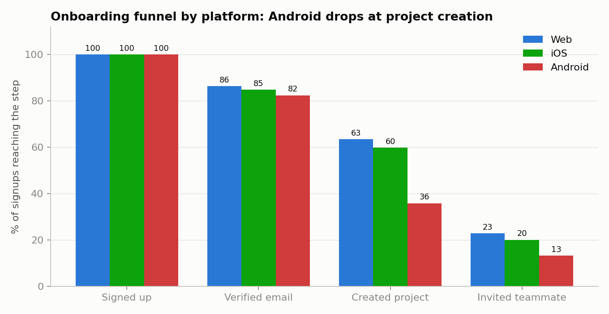
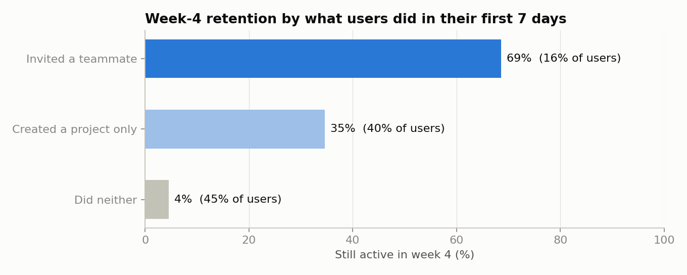

# FunnelLens: Onboarding Funnel & Retention Analysis

Finds where new users drop off during onboarding, which early action goes with users staying, and how many users a fix would win back, using SQL over 8,000 signups and 40,000 product events.

Built with SQL (SQLite) and Python (pandas, matplotlib). The output CSVs load directly into Power BI or Excel.

> **Data note:** the dataset is synthetic. `src/build_database.py` simulates six months of signups for a made-up team task app with a fixed seed. The numbers are reproducible but not from a real company.

## The question it answers

A product team that wants more active users needs to know: *where are we losing new users, and what should we fix first?* This project answers it in three steps:

1. **Where do users drop off?** A funnel from signup to inviting a teammate, split by platform.
2. **Do they come back?** Retention in week 1, 4 and 8 for each signup month.
3. **What do the users who stay have in common?** Retention compared by what users did in their first 7 days.

## Results



| Platform | Signed up | Verified email | Created project | Invited teammate | Verified → created |
|---|---|---|---|---|---|
| All | 8,000 | 84.9% | 55.4% | 19.7% | 65.3% |
| Web | 3,665 | 86.3% | 63.4% | 22.9% | 73.5% |
| iOS | 2,330 | 84.8% | 59.8% | 20.1% | 70.5% |
| Android | 2,005 | 82.4% | 35.8% | 13.2% | 43.4% |

What the analysis shows:

- **The biggest drop is at creating a first project, and it is an Android problem.** Only 43.4% of verified Android users create a project, against 73.5% on Web. The other steps convert about the same on every platform.
- **Fixing it is worth about 500 users.** If Android converted at the Web rate, 498 more users would create a project, an 11.2% increase on today's 4,435.
- **Inviting a teammate in week one goes with staying.** 68.6% of users who invite a teammate in their first 7 days are still active in week 4, against 34.6% of those who only create a project and 4.5% of those who do neither. Only 15.6% of users invite a teammate that early.
- **Retention is steady across months.** About 34% of users are active in week 1, 26% in week 4 and 19% in week 8, with no signup month much better or worse.



**What I would do with this:** first, look into the Android project-creation screen, since the drop is on one platform and one step. Second, test prompting users to invite a teammate right after they create their first project, and measure whether week-4 retention moves.

## How it works

**Data model** (SQLite, `data/product.db`):

```
users   user_id, signup_date, platform
events  event_id, user_id, event_name, event_date
```

Event names: `signed_up`, `verified_email`, `created_project`, `invited_teammate`, `session`.

**SQL** (`sql/`):

| File | What it does | SQL used |
|---|---|---|
| `01_funnel.sql` | Users reaching each onboarding step and step-to-step conversion, overall and by platform | CTEs, conditional aggregates, `UNION ALL` |
| `02_cohort_retention.sql` | Week 1, 4 and 8 retention by signup month | date arithmetic, `CASE`, cohort grouping |
| `03_activation.sql` | Week 4 and 8 retention by first-week behaviour, with each group's share of users | CTEs, `CASE`, window `SUM() OVER` |

**Definitions.** Week N covers days 7N to 7N+6 after signup. A user is retained in week N if they have a session in that week. A user only counts toward week N if the whole week falls inside the data, so June signups show no week-8 number rather than a misleadingly low one.

## Run it

```bash
python -m venv .venv && source .venv/bin/activate
pip install -r requirements.txt
python src/build_database.py   # writes data/product.db
python src/analyze.py          # runs the SQL, writes outputs/
```

## Project layout

```
data/      product.db (generated)
sql/       the three queries
src/       build_database.py, analyze.py
outputs/   funnel.csv, cohort_retention.csv, activation.csv, charts
```

## Limitations

- The data is simulated, with the Android drop and the teammate effect built in on purpose, so the findings show the method working rather than a real result.
- The teammate finding is a correlation. Users who invite a teammate may already be more committed, so the invite prompt needs an A/B test before anyone claims it causes retention.
- The 498-user estimate assumes Android can reach the Web rate, which is the best case.
- The funnel shows where users drop off, not why. That needs session recordings, user interviews or bug reports.
